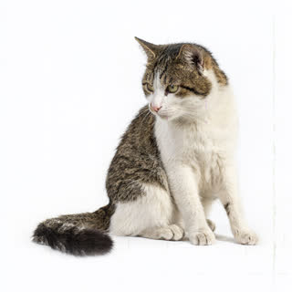
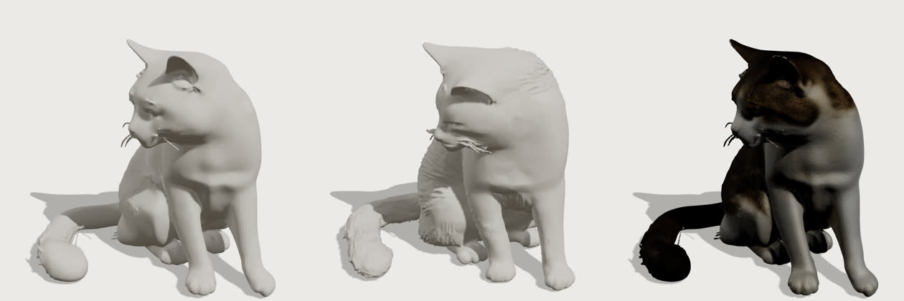
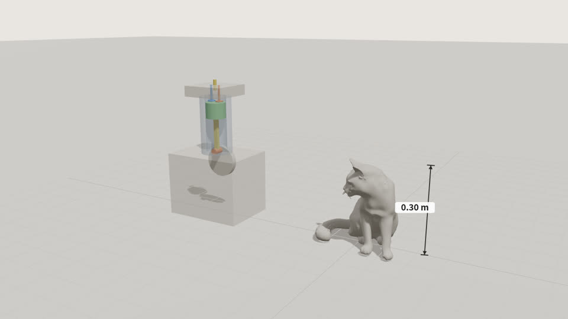

# 图生 3D 模块（mesh）

用途：3D 白模预演（[PREVIS_CONTRACT.md](PREVIS_CONTRACT.md) 第 4.6 节）里的有机形体资产，比如动物、雕塑、植物。参数化建模做不好这类形状，就用一张概念图生成网格，再按真实尺寸放进素材库。机械、建筑这类规整的东西还是走参数化建模。

## 1. 流程

```
提示词 ──image.generate()（Qwen-Image，1:1）──▶ 概念图 ─┐
图片素材 ─────────────────────────────────────────────┴─▶ mesh.generate()（Hunyuan3D-2，GPU）
  ─▶ 原始 GLB（Hunyuan 自己的单位立方体）─▶ assets_build.normalize()（A：缩放到目标尺寸、落地、减面）─▶ 素材库 model
```

- 概念图提示词模板：「<提示词>。单个物体，纯白背景，三分之二侧视角，完整不裁切，无投影，画面中没有任何文字」。
- 默认只出几何（白模渲染时材质统一换成黏土色，用不到贴图）。`texture: true` 时再跑 Hunyuan3D-2 Paint，输出带 2048² 底色贴图的 GLB。
- 入口：`POST /api/assets/model/image3d`（后台任务）和工作流节点 `asset.image3d`，两者走同一个函数 `mesh_api.run_image3d()`。

## 2. 文件

| 文件 | 作用 |
|---|---|
| `infra/mesh/container/` | Dockerfile、适配层 `serve.py`（8080：`/ping`、`/invocations`）、导入检查 `check_imports.py`、`requirements.txt` |
| `infra/mesh/stage_weights.py` | HF → S3，固定 commit，逐个文件下载、上传、核对大小后删除（本机就能跑，最多占一个文件的磁盘） |
| `infra/mesh/builder.py` + `builder.sh` | 临时 x86 构建机（c7i.4xlarge，150 GB gp3，关机即终止，90 分钟硬上限），构建并推送 `evp/mesh:<tag>` |
| `infra/mesh/bench.py` | 从 0 实例实测：概念图（或固定图片）→ 依次跑各个用例，结果写 `data/mesh_smoke/results.json` |
| `infra/mesh/set_still.py` | 把一个入库的模型放进一次性布景（可带四冲程发动机作比例参照），经 B 的编译检查后渲染一张静帧 |
| `infra/mesh/preview/render.sh` | 本机渲染 GLB 预览静帧（Remotion + `@remotion/three`，`--gl=swangle`） |
| `infra/mesh/iam/` | 本模块需要的两条内联策略（工作机、构建机） |
| `infra/gpu_ec2/modules/mesh.json` | GPU 工作机配置，格式同 `image.json` |
| `server/app/mesh.py` | 工作室客户端：`status()`、`generate(image, model, texture, seed, **kw) -> GLB` |
| `server/app/mesh_api.py` | HTTP 接口和后台任务（`data/mesh3d/<id>/`） |
| `server/app/mesh_node.py` | `asset.image3d` 节点，`register(NODES)` |

通用 worker（`infra/gpu_ec2/worker/**`）没有改动：结果里的 `glb_b64` 由 `outputs: {"glb_b64": "glb"}` 存成 `out/<id>.0.glb`。

## 3. 模型和权重

代码：Tencent-Hunyuan/Hunyuan3D-2@`f8db6309`（不 pip 安装，用 `PYTHONPATH` 引用，避免它的 setup.py 把 diffusers、transformers 顶到新版）。

权重：`s3://evp-models-747411437379-us-east-1/weights/hunyuan3d-2/9cd649ba6913f7a852e3286bad86bfa9a2d83dcf/`（tencent/Hunyuan3D-2 的 commit），34 个文件，23.35 GB，2026-11-25 从本机上传并逐个核对过大小，清单在 `_evp_manifest.json`。

| 目录 | 大小 | 用途 |
|---|---|---|
| `tencent/Hunyuan3D-2mini/hunyuan3d-dit-v2-mini/`（@`f90a0f7d`） | 3.8 GB | 形状 2mini（0.6B），fp16 safetensors |
| `tencent/Hunyuan3D-2/hunyuan3d-dit-v2-0/` | 4.9 GB | 形状 2.0（1.1B），fp16 safetensors |
| `tencent/Hunyuan3D-2/hunyuan3d-paint-v2-0-turbo/` | 10.3 GB | Paint 多视角扩散（turbo） |
| `tencent/Hunyuan3D-2/hunyuan3d-delight-v2-0/` | 4.3 GB | Paint 去光照 |

- 每个形状检查点里自带 VAE 和 DINOv2 条件编码器，不需要单独的 `vae-*` 目录。
- Paint 的 UNet 加载器（`hunyuanpaint/unet/modules.py`）只读 `diffusion_pytorch_model.bin`，所以拷的是 .bin（7.3 GB），没拷同目录的 .safetensors。
- 容器设 `HY3DGEN_MODELS=/opt/ml/model`，hy3dgen 的加载器直接在本地找到这些目录，不访问 HF（另外设了 `HF_HUB_OFFLINE=1`）。
- 背景去除用 rembg 的 u2net，`u2net.onnx` 在构建时下载进镜像（核对 md5），工作机不需要访问 GitHub。

## 4. 镜像

当前 `evp/mesh:20261125-061845`（ECR 仓库 `evp/mesh`，`scanOnPush`，v2 清单，压缩后 10.6 GB）。CUDA 12.8.1 + cuDNN devel、Ubuntu 22.04、Python 3.10、torch 2.7.1+cu128。固定的版本见 `requirements.txt`，其中：

- `diffusers==0.31.0`（新版会调用 torch 2.6+ 的 API）、`huggingface-hub==0.28.1`、`transformers==4.48.3`（hy3dgen 要求 ≥ 4.48）。
- `xatlas`、`rembg`、`onnxruntime`、`omegaconf`、`pygltflib`、`pymeshlab`、`trimesh`。
- Paint 的两个扩展在镜像里编译：`custom_rasterizer`（CUDA，`TORCH_CUDA_ARCH_LIST="8.9;12.0"`，覆盖 L40S 和 Blackwell RTX PRO）和 `mesh_processor`（C++，`build_ext --inplace`，不然渲染器会退回到慢的纯 Python 版本，导入检查会拦下这种情况）。
- `HF_HUB_DISABLE_SYMLINKS=1`。

依赖能否解析已在本机用 `pip install --dry-run --platform manylinux_x86_64 --python-version 3.10` 检查过（78 个包，torch 来自 cu128 索引）。改过的版本：`pygltflib` 1.16.3 只有源码包，改成 1.16.5。

适配层：

- 启动时先跑导入检查（失败就退出，worker 随即关机），然后在后台加载 `MESH_PRELOAD`（默认就是默认模型）和 rembg，加载完 `/ping` 才返回 200。另一个形状模型和 Paint 在第一次用到时加载，之后常驻（三个加起来在 32 GB 卡上也放得下）。
- 处理：解码图片 → 不是真正的抠图（至少 1% 像素 alpha ≤ 16）时用 rembg 去背景 → 形状模型（`octree_resolution`、`steps`、`guidance`、`seed`）→ `FloaterRemover`、`DegenerateFaceRemover`、`FaceReducer` 减到 `max_faces` → 可选 Paint → 导出 GLB。
- 贴图时先减到最多 4 万面再上色：Paint 的 UV 展开（xatlas）和烘焙在 CPU 上跑，在很密的网格上会卡住（在另一个项目实测过 100 万面卡了 9 小时以上），Hunyuan 官方也是先减到约 4 万面。
- 响应：`{"glb_b64", "seconds", "meta": {"model", "render_s", "faces", "vertices", "raw_faces", "textured", "peak_vram_gb", "torch_peak_gb", "gpu", "shape_s", "post_s", "paint_s", "rembg_s", "load_s", ...}}`。`peak_vram_gb` 用 nvml 采样（含 CUDA 上下文和缓存），`torch_peak_gb` 是 torch 自己的峰值。

## 5. 实测（2026-11-25，us-east-1）

镜像 `evp/mesh:20261125-061845`（10.6 GB 压缩，构建约 9 分钟）。输入是图像模块按第 1 节的模板出的「一只坐着的猫」概念图（1440×1440，seed 42），每个用例 seed 42、30 步、`octree_resolution` 256、`guidance` 5.0。两轮都从 0 实例开始，按 2mini → 2.0 → 贴图的顺序在同一台工作机上连着跑，所以第一个用例含冷启动，后面的用例含第一次加载那个模型的时间。

 

左：概念图。右三张（本机 `infra/mesh/preview/render.sh`，相机在 +Z）：2mini 白模、2.0 白模、2mini + Paint 贴图。

| 用例 | 机型 | 从提交到拿到 GLB | 工作机用时（`render_s`） | 其中 | 面数（原始 → 减面后） | 峰值显存（nvml / torch） |
|---|---|---|---|---|---|---|
| 2mini，只出几何（冷启动） | 按需 g7.2xlarge（RTX PRO 4500 Blackwell 32 GB） | **357 秒**、359 秒 | 13.8 秒、12.9 秒 | 形状 8.7 秒，清理减面 4–5 秒，去背景 0.2 秒 | 455,270 → 60,000 | 5.6 / 4.3 GB |
| 2.0，只出几何 | 同一台 | 41 秒、51 秒 | 36.3 秒、33.9 秒 | 第一次加载 16 秒，形状 14 秒，减面 3–6 秒 | 513,854 → 60,000 | 10.5 / 9.1 GB（2mini 也常驻） |
| 2mini + 贴图 | 同一台 | 41 秒、41 秒 | 37.5 秒、37.2 秒 | 第一次加载 Paint 13 秒，Paint 12 秒，形状 7 秒 | 455,270 → 40,000 | 22.1 / 18.3 GB（三个模型都常驻） |
| 2.0 + 贴图 | 同一台 | 41 秒 | 33.4 秒 | 形状 14 秒，Paint 12 秒 | 513,854 → 40,000 | 22.1 / 18.3 GB |

两个数字的格子是两轮（第二轮在前）。第一轮的输入没有去背景（见下面的问题 1），面数和形状都不能用，只取了时间。

冷启动 357 秒的分解（第二轮）：提交后依次尝试容量选项 24 秒拿到实例，开机到 bootstrap 开始 52 秒，bootstrap 开始到 `/ping` 200 共 257 秒，其中拉镜像 136 秒、同时拷权重 49 秒（23 GB），容器启动、导入检查、加载 2mini 和 rembg 约 70 秒；之后第一个任务 14 秒，加上轮询间隔。

GLB 大小：白模约 1.1 MB；带贴图 4.4–4.9 MB（2048² 底色贴图）。

**选型：默认 2mini。** 白模预演只用轮廓和比例，2mini 的轮廓和 2.0 一样完整，表面反而更干净：2.0 把概念图里的毛发纹理做成了一道道凸起（上图中间），2mini 平滑得多。2mini 快 2.6 倍（13.8 秒对 36 秒，热状态下 2.0 约 20 秒），显存少一半。要更多表面细节时可以在请求里选 `hunyuan3d-2`。

**机型：** 两轮都拿到按需 g7.2xlarge（us-east-1a）。三个模型全部常驻时峰值 22.1 GB，32 GB 的卡还有余量，所以最便宜的 Spot g7.2xlarge（约 $0.51/小时）也能跑。容量顺序（`mesh.json`）：按需 g7.2xlarge → g6e.2xlarge → g7e.2xlarge，然后同样顺序的 Spot，每种两个可用区。g7.2xlarge 排第一是因为它是唯一实测跑通的机型；g6e（L40S，sm_89）和 g7e（RTX PRO 6000，sm_120）用的是同一个镜像，扩展编译时包含这两种架构，显存更大，但没有在上面实际跑过。g6e 按需更便宜（$2.24 对 $2.52/小时），但第二轮时它排第一，控制器仍然用了 24 秒才落到 g7.2xlarge（尝试记录没有保存，推测 g6e 当时没有容量）。

### 端到端（工作室接口）

在自己起的工作室（127.0.0.1:8769，单独的 `EVP_DATA`）上 `POST /api/assets/model/image3d`，`{"prompt": "一只坐着的猫", "target": {"axis": "h", "metres": 0.3}}`：

- 第二轮：486 秒完成。概念图 433 秒（图像模块从 0 冷启动），网格 30 秒（工作机已热），规范化 + 转台图 20 秒。入库 `model`，`meta.size` = **[0.302, 0.300, 0.261] 米**（高 0.3 米，误差 < 0.001%），60,000 面，`source` 带 `prompt` / `model` / `seed` / `target`。
- 第一轮：358 秒（概念图 51 秒，网格工作机冷启动中等了 283 秒）。

放进布景（`infra/mesh/set_still.py`：B 的镜头编译和检查 0 个问题，Remotion + swangle 渲染第 45 帧），旁边是四冲程示例发动机，尺寸标注 0.30 m：



### 朝向

- **+Y 向上**：网格直立，`normalize-glb` 落地后底面在 y = 0（`bbox.min[1]` = 0）。
- **输入图的视角 = +Z**：从 +Z 看（上面三张预览的相机）和概念图的画面一致。Hunyuan 把输入图当作正视图，和 glTF「正面朝 +Z」的约定一致，所以 normalize 和适配层都不用转。
- 概念图模板要的是「三分之二侧视角」，所以物体本身的正面并不正对 +Z：这只猫的脸朝向 −X 偏 +Z 约 45°。需要它正面朝镜头时，在布景里给物体加 `rot_deg: [0, 45, 0]` 一类的转角（`SetObject.rot_deg`），不要在资产里改。

### 修过的问题

1. **白色地面被重建成一块底板。** 图像模块输出的 PNG 是 RGBA，透明度最低 181（几乎不透明），适配层把「有透明度小于 255 的像素」当成已经抠好的图，跳过了 rembg（第一轮 `rembg_s` 都是 0），结果概念图里的白色地面变成了猫脚下一块破碎的底板（`raw_faces` 也少了 9 万）。改成：至少 1% 的像素几乎全透明（alpha ≤ 16）才算抠图；工作室端 `mesh.prepare_image()` 同样规则，不算抠图的 RGBA 先铺到白底上转成 RGB。镜像重建为 `20261125-061845`，第二轮 `rembg_s` 0.1–0.2 秒，底板消失。
2. **第一次构建失败**：`custom_rasterizer` 用 `--no-build-isolation` 构建，venv 里没有 `wheel`（`invalid command 'bdist_wheel'`）。Dockerfile 先装 `setuptools==75.8.0`、`wheel==0.45.1`。

### 复现

```bash
python3 infra/mesh/builder.py launch            # 约 9-10 分钟；记下输出里的 image
python3 infra/mesh/builder.py status <run>      # status.json：build=0
# 把 infra/gpu_ec2/modules/mesh.json 的 "image" 改成上面的 tag
python3 infra/mesh/bench.py --cases 2mini,2,2mini+tex,2+tex --stop   # 从 0 实例；先用图像模块出概念图
infra/mesh/preview/render.sh data/mesh_smoke/2mini.glb out.jpg clay 0 90
EVP_DATA=<工作室数据目录> python3 infra/mesh/set_still.py <data/assets/<id>> set.png --engine
```

本次 GPU 用时：mesh 工作机两台 g7.2xlarge 按需，06:10–06:17 和 06:28–06:37，共 0.26 小时（第一台由 `bench.py --stop` 终止，第二台用 `GpuEC2("mesh").stop()`）；概念图用的图像模块 g6e.2xlarge 按需两台，各自出图后闲置 15 分钟自己关机，共约 0.8 小时；构建机 c7i.4xlarge 三次共约 0.4 小时（非 GPU，构建完自己关机）。

## 6. 工作室接口

`POST /api/assets/model/image3d`，JSON：

```json
{"prompt": "一只坐着的猫", "target": {"axis": "h", "metres": 0.3},
 "model": "", "texture": false, "seed": 42, "name": "猫", "project_id": null}
```

- `prompt` 和 `image_asset`（素材库里的图片 id）只能给一个；`target.axis` 是 `w / h / d / longest`，`metres` 在 0.001–1000 之间。
- 返回 202 `{"task_id", "status": "queued", ...}`。任务状态 `GET /api/mesh/tasks/{id}`（`queued|running|done|failed`、`step`、`notes`、完成后的 `asset_id` 和 `mesh_meta`），文件 `GET /api/mesh/tasks/{id}/concept|input|raw`，失败重试 `POST /api/mesh/tasks/{id}/retry`（已有的概念图和原始 GLB 直接复用），列表 `GET /api/mesh/tasks`，GPU 状态 `GET /api/mesh/status`。
- 输入图片在工作室端检查并重新编码成 PNG（png / jpg / webp，短边 ≥ 128，长边 ≤ 8192，≤ 20 MB，长边缩到 1024，保留透明通道：带透明通道的图在工作机上跳过去背景）。
- 规范化通过 `mesh_api.set_normalize(fn)` 注入，默认调 A 的 `app.previs.assets_build.normalize(raw_glb, target, source, name, project_id)`。`source` 写 `{"type": "image3d", "model", "seed", "target", "prompt" 或 "image_asset"}`（对应 `types.ts` 的 `ModelMeta.source`）。

## 7. IAM（用户已于 2026-11-25 用管理员身份跑过）

本模块加了两条内联策略，不改已有的策略：`evp-gpu-worker` 的 `evp-gpu-worker-mesh`（MeshJobs、MeshJobsList、MeshEcrPull），`evp-video-builder` 的 `evp-builder-mesh`（MeshBuildRun、MeshEcrPush），集成方已实际核对。重建时在 CloudShell 的仓库根目录跑：

```bash
aws iam put-role-policy --role-name evp-gpu-worker --policy-name evp-gpu-worker-mesh \
  --policy-document file://infra/mesh/iam/worker-mesh.json
aws iam put-role-policy --role-name evp-video-builder --policy-name evp-builder-mesh \
  --policy-document file://infra/mesh/iam/builder-mesh.json
aws iam get-role-policy --role-name evp-gpu-worker --policy-name evp-gpu-worker-mesh --query PolicyName --output text
aws iam get-role-policy --role-name evp-video-builder --policy-name evp-builder-mesh --query PolicyName --output text
```

`infra/gpu_ec2/grant_worker_role.sh` 也加上了 mesh 的几行（工作机的 `jobs/mesh-ec2/*`、`evp/mesh` 拉取，构建机的 `evp-builder-mesh`），以后整套重建时一起生效。权重读取（`weights/*`）、ECR 登录和 PassRole 已有，不用再加。

## 8. 成本

- 权重 23 GB S3 标准存储约 $0.54/月；镜像约 10 GB 约 $1/月。
- 一次使用：冷启动 6 分钟 + 几次生成（每次 15–40 秒）+ 闲置 15 分钟，约 22 分钟。按需 g7.2xlarge（$2.52/小时）约 $0.9，Spot g7.2xlarge（约 $0.51/小时）约 $0.2。提示词入口另外要启动图像模块（按需 g6e.2xlarge 约 22 分钟，约 $0.8）。
- 构建一次镜像：c7i.4xlarge（$0.71/小时）约 10 分钟，约 $0.12。
