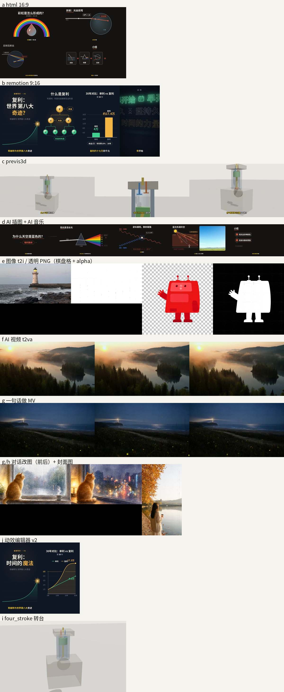

# pillow 13.0.0 全量回归测试报告（2026-11-25）

测试对象：master `b971e51`（#50 之后），分支 `test/pillow13-regression`。工作室跑在自己的 127.0.0.1:8771，`EVP_DATA` 是新建的空目录，`EVP_MOTION_PORT=5298`，`EVP_FEEDBACK_AUTO_OPEN=0`、`EVP_FEEDBACK_AUTOCHECK=0`。数字人模块和图生 3D 模块按要求没有启动，只跑了它们的单元测试。

结论：**没有发现 pillow 13 引起的问题，没有改代码。** 发现的两个失败都和 pillow 无关（见第 4 节）。

## 1. 版本

| 位置 | Python | pillow | 来源 |
|---|---|---|---|
| 工作室 venv `~/.cache/explainer-video/venv` | 3.12.3 | 13.0.0 | `pip show pillow` |
| 图像容器 `infra/image/container` | 3.11 | 13.0.0 | `requirements.txt` 第 7 行（#6 起）；线上镜像 `qwen-image:20261103-125014-amd64` 在 #6 之后构建，容器里的版本没有直接读到 |
| 图生 3D 容器 `infra/mesh/container` | 3.12（Ubuntu 24.04） | 13.0.0 | `requirements.txt` 第 23 行（#50） |
| 数字人容器 `infra/avatar/container` | 3.10（Ubuntu 22.04） | 12.3.0 | `requirements.txt` 第 37 行；另一个 agent 正在升级，本次不动 |
| 音乐容器 `infra/music/container` | 3.11 | 不直接依赖 | `requirements.txt` 没有 pillow |
| 视频容器 `infra/video/container` | 基础镜像自带 | 不直接依赖 | Dockerfile 只装 fastapi、uvicorn |

工作室 venv 里的相关库：FreeType 2.14.3，HarfBuzz 14.5.0，raqm 可用。

## 2. PIL API 审计

用到 PIL 的生产代码和用到的 API：

| 模块 | 用到的 API |
|---|---|
| `server/app/assets/store.py` | `Image.open`、`verify`、`convert("RGBA")`、`Image.new`、`paste(mask=split()[3])`、`thumbnail`、`resize`、`save(JPEG)`、`width/height` |
| `server/app/avatar.py` | `Image.open`、`verify`、`size`、`convert("RGBA")`、`Image.new`、`paste(mask=)`、`save(PNG)` |
| `server/app/mesh.py` | `Image.open`、`verify`、`mode`、`info["transparency"]`、`convert`、`getchannel("A").histogram()`、`paste(mask=)`、`thumbnail(..., Image.LANCZOS)`、`save(PNG)` |
| `server/app/llm.py` | `Image.open`、`convert("RGB")`、`resize(..., Image.LANCZOS)`、`save(JPEG, quality=)` |
| `server/app/remotion/project.py` | `Image.open`、`convert("RGB")`、`resize`、`getextrema` |
| `server/app/previs/shots.py` | `Image.new`、`ImageDraw.Draw`（`rectangle`、`line`、`ellipse`、`text`）、`ImageFont.truetype(index=2)`、`ImageFont.load_default` |
| `skills/explainer-video-pipeline/scripts/song_map.py` | `ImageDraw`（`polygon`、`line`、`ellipse`、`text(anchor="mm")`、`textbbox`）、`ImageFilter.GaussianBlur`、`Image.composite/blend/merge`、`point`、`resize(Image.BILINEAR)`、`ImageFont.truetype(index=2)`、`save(optimize=True)` |
| `infra/image/container/serve.py` | `Image.open(...).convert("RGB")`、`crop`、`save(PNG)` |
| `infra/mesh/container/serve.py` | `Image.open`、`load`、`mode`、`getchannel("A").histogram()`、`convert` |
| `infra/avatar/container/lc_runner.py` | `Image.fromarray(f)`（不带 `mode`）、`size` |

另有只在测试或开发脚本里用的：`server/tests/*`（`Image.new/open`、`ImageChops`）、`web/mock-*-e2e.py`、`web/src/pages/previs/mocks/shoot_ui.py`（截图缩小）。

对照 [Pillow 13.0.0 发布说明](https://pillow.readthedocs.io/en/stable/releasenotes/13.0.0.html)：

| 13.0.0 的变化 | 本仓库 | 结论 |
|---|---|---|
| 不再支持 Python 3.10 | 数字人容器是 3.10，但仍钉在 12.3.0 | 不受影响（升级由另一个 agent 处理） |
| I 模式图片存 PNG 不再自动截断 | 没有 I 模式 | 无 |
| `Image.fromarray` 的 `mode` 参数（改数据类型时） | `lc_runner.py` 不传 `mode` | 无 |
| `get_child_images`、`Image._show`、`ImageCms` 的 `product_name/info`、`ExifTags.IFD.Makernote` 移除 | 没用到 | 无 |
| 弃用 IM 格式、`load_djpeg`、`ImageQt.align8to32` | 没用到 | 无 |
| `ImageColor.getcolor` 预乘模式、TIFF 重复标签、小 ICO | 没用到 | 无 |
| `resize` 的 `reducing_gap` 现在也作用于 RGBA/LA（`thumbnail` 默认 2.0） | `mesh.py` 对 RGBA 图 `thumbnail`；`store.py` 先合成到 RGB 再缩 | 只是缩放算法细节变化，像素有微小差异，不影响功能 |
| wheel 改为链接自带的 HarfBuzz，自动 hinting 可能略有不同 | `shots.py`、`song_map.py` 画中文字 | 俯视图文字目测正常（中文、数字、箭头），像素级可能有差异，没有测试依赖精确像素 |
| 带掩码的 LA/PA 直方图修正 | `histogram()` 不带掩码 | 无 |

全仓库搜 `ANTIALIAS`、`textsize`、`getsize(`、`get_child_images`、`_show(`、`load_djpeg`、`align8to32`、`Makernote`、`product_name`：除了 `os.path.getsize` 没有命中。`Image.LANCZOS`、`Image.BILINEAR` 在 13.0.0 里仍然可用。在 venv 里用 `-W error` 导入并检查这些常量，没有弃用警告；PIL 相关的 5 个测试文件加 `-W error::DeprecationWarning:PIL` 重跑，102 个全部通过。

## 3. 自动化测试

| 测试 | 结果 | 用时 |
|---|---|---|
| `server/app/previs/js/test.sh` | 通过：core 7、asset 20、shot 25 | 1.8 秒 |
| `cd server && $PY -m pytest -q tests`（含 `test_avatar*.py`、`test_mesh.py`） | **510 passed**，rc=0，10 个警告都是 FastAPI `on_event` 和 httpx 的弃用警告，没有 PIL 的 | 166 秒 |
| PIL 相关测试 + `-W error::DeprecationWarning:PIL` | 102 passed | 86 秒 |
| `web`：`npm ci` + `npm run build` | 通过（只有 chunk 大于 500 kB 的提示） | 2 秒 |
| `web/src/components/voiceLive.test.mjs` | 4/4 通过 | <1 秒 |
| `web/mock-assist-e2e.py`（mock 在 8823，因为 8803 已被别人占用） | ALL PASS（30 项） | 约 1 分钟 |
| `web/mock-revoice-e2e.py` | **45/46**：`applied narrations become the new baseline` 失败，和 pillow 无关，见第 4 节 | 约 1 分钟 |
| `web/mock-motion-e2e.py` | **6 项通过后超时**：等 `.mv-item video`，和 pillow 无关，见第 4 节 | 30 秒超时 |

没有跑的：`infra/*/container/check_imports.py`（在 GPU 容器里跑）、`infra/previs/bench`（基准测试）、`scripts/dev/revoice_*.py`（依赖主 checkout 里的特定作品）。

## 4. 端到端（127.0.0.1:8771）

| 项 | 能力 | 结果 | 用时 | 检查了什么 |
|---|---|---|---|---|
| a | 讲解视频 html，30 秒，16:9，合成垫乐 | 通过 | 228 秒 | 成片 30.13 秒 1920×1080 H.264 + AAC；分镜 13 秒、绘制代码 47 秒、Whisper 字幕 65 秒、逐帧渲染 90 秒、合成 11 秒；混音 `sfx yes`，整体 −22.4 dB；看了 4 帧：棱镜、折射、反射、小结，逐字高亮字幕正常 |
| b | 讲解视频 remotion，30 秒，9:16，版面检查开 | 通过 | 371 秒 | 成片 29.31 秒 1080×1920；版面检查 9 次视觉调用 127 秒：1 段修复、1 段没问题、3 段问题没减少保留原版（按设计）；看了 4 帧：标题、复利树、柱状图、霓虹收尾 |
| c | 讲解视频 previs3d，four_stroke（`scenes` + `previs_plan`，只用 CPU） | 通过 | 446 秒 | 成片 28.84 秒 1920×1080；3 个镜头无 error、3 个 warn；镜头渲染 274 秒；看了 3 帧（发动机、剖切气缸、做功）和 PIL 画的俯视图 `s02.plan.png`（中文标签、相机路径、关键帧编号都正常） |
| d | 讲解视频 + 1 张 AI 插图 + AI 音乐，30 秒 | 通过 | 972 秒（含冷启动） | 插图 512 秒（含冷启动），出现在第 4 段右半；AI 音乐第 1 次 Whisper 转出歌词，按设计换 seed、`cot=off` 重试，第 2 次 63 秒纯音乐无人声；成片 30.12 秒 |
| e | 图像页：16:9 文生图 + 1:1 透明 PNG | 通过 | 473 / 433 秒（含冷启动等待约 7 分钟） | 灯塔 1920×1080；透明图 1440×1440 RGBA，背景 alpha 为 0、机器人主体 255，在棋盘格上看边缘干净。注意：t2i 的 PNG 也是 RGBA，alpha 最小 186、92.5% 像素为 255，alpha 通道里能看到 VAE 分块的淡痕，这是模型输出，图像容器只做 `crop` 和 `save`，工作室不经过 PIL |
| f | 视频页 t2va 5 秒 16:9（ap-south-1） | 通过 | 718 秒（等 GPU 619 秒） | 1344×768 24 fps，5.18 秒，带 AAC 音轨；3 帧有镜头运动 |
| f | 音乐页纯音乐 | 通过（长度不可控） | 440 秒 | 48 kHz 立体声 FLAC + `score.abc`，162.6 秒，平均 −18.7 dB。要求的 30–60 秒做不到：纯音乐长度由模型决定，接口没有时长参数（STUDIO.md 也这样写） |
| g | 工作流「封面图」 | 通过 | 720 秒（含冷启动和审核） | 通过 API 批准 `n4`；输出 1080×1920 PNG；同一工作流重跑 30 秒，`n2`、`n3` 都是 `cached`，没有调 GPU |
| g | 工作流「一句话做 MV」 | 通过 | 890 秒 | 歌 660 秒、图 542 秒、视频 201 秒（视频 GPU 已热）、混音 90 秒；批准 `n9`；成片 90 秒 1344×768，画面正放倒放循环，音频 −15.6 dB |
| g | Agent 用一句话生成工作流（只校验） | 通过 | 17 秒 | 第 1 轮就 valid，13 个节点；`/api/workflows/validate` 再校验也是 valid |
| h | 对话创作：生图 + 「改成夜景」 | 通过 | 第一次 801 秒（含冷启动和审核），改图 89 秒 | 改图只重跑 `n2`、`n3`；两张图对比：雨天白昼 → 夜景城市灯光，猫和窗台保留 |
| i | 素材库上传 PNG/JPG/MP4/MP3/GLB | 通过 | 每个 0.01–0.04 秒，GLB 27 秒（含转台） | PIL 缩略图：PNG 320×240（半透明红色正确合成到白底，中心像素 (228,102,87)）、JPG 320×180、MP4 320×180、GLB 转台缩略图 1280×720；MP3 按设计没有缩略图 |
| i | 构建 four_stroke 参数化模型 + 转台 | 通过 | 18 秒 | 1956 个三角面，转台 4.05 秒 1280×720 120 帧，看了一帧 |
| j | 动效编辑器（作品 b） | 通过 | 打开 10 秒，助手 3.4 秒，重写一段 76 秒，重配 9 秒，v2 渲染 114 秒 | 用无头 Chromium 打开 `/motion/?import=project` 拿到工程；助手把标题改成「时间的 / 魔法」（`set_props`）；重写 `simple_vs_compound` 为折线图并应用；只重配这一段（249 → 299 帧，抽查 `title_card` 声音一致）；保存 v2：30.98 秒，帧里标题和折线图都对，Whisper 转写这一段是新旁白 |
| k | 反馈：作品 a 上提交「不满意」 | 通过 | 分析约 4 秒 | 结论 `rule`、`mix:music_over_voice`，依据质检 `voice_minus_music_db=-0.45`；聚类 1 条（门槛 3），没有起草，没有开 PR（`EVP_FEEDBACK_AUTO_OPEN=0`、`AUTOCHECK=0`） |
| l | 设置页 GPU 模块列表 | 通过 | 2 秒 | `/api/settings/deploy` 返回 avatar、image、mesh、music、video 五个模块，状态、机型、镜像标签都对；`/api/mesh/status` 只读，idle、0 台 |

### 和 pillow 无关的问题

1. **`web/mock-revoice-e2e.py` 一项失败**：应用新配音后，S7 文本框里还是旧旁白，所以「新旁白成为基线」这一项不过。在引入这个测试的提交 `3e6464e`（#37）上用同一个 venv 重跑，同样是 45/46、同一项失败，所以不是后来的改动引起的。这个检查比的是页面上文本框的值，PIL 只用来缩小截图。可能原因：mock 读的是主 checkout 里的作品 `20261111-075413-d48e69`，它的 `versions/` 在 11-13 还被改过，测试写死的旁白和现在的数据对不上。没有改。
2. **`web/mock-motion-e2e.py` 超时**：等 `.mv-item video`，但 #34（作品页选版本）以后版本列表里不再放 `<video>`；这个测试最后一次改是 #29，比 #34 早，测试过期了。没有改。
3. **观察**：合成垫乐的作品 a，质检测得人声只比音乐高 −0.45 dB（阈值 6 dB），反馈分析据此判断为规则问题。这是混音参数本身的问题，和 pillow 无关，这次没改。

## 5. GPU 用量

| 模块 | 实例 | 开机 | 自己关机 | 时长 |
|---|---|---|---|---|
| 图像 | i-04e856902c1d63b3d，按需 g6e.2xlarge，us-east-1a | 08:01:33 | 08:31:58 前 | ≤ 0.51 小时 |
| 音乐 | i-0c47896c68a9b5f01，按需 g6.2xlarge，us-east-1b | 08:01:55 | 08:31:58 前 | ≤ 0.50 小时 |
| 视频 | i-0deae341a1b3c83b8，Spot g7e.4xlarge，ap-south-1b | 08:02:53 | 08:31:58 前 | ≤ 0.49 小时 |

合计 **≤ 1.5 GPU 小时**（上限 3 小时）。所有 GPU 请求在 08:01–08:02 一起提交，冷启动重叠；最后一次用 GPU 在 08:16 左右，三台都在空闲 15 分钟后自己终止，08:31:58 已是 `shutting-down`。没有碰数字人和图生 3D 实例（期间看到的 `mesh-builder`、`avatar-builder` 是别的 agent 的 c7i 构建机）。
